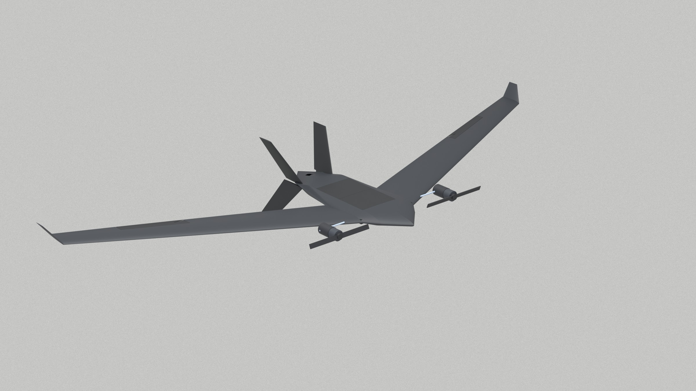
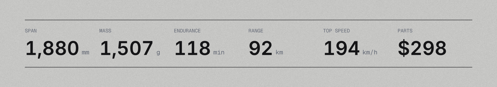
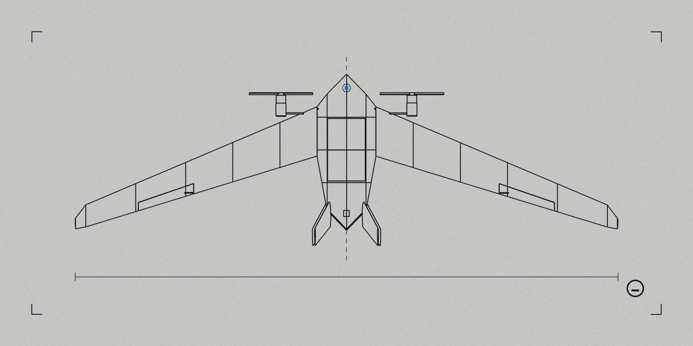
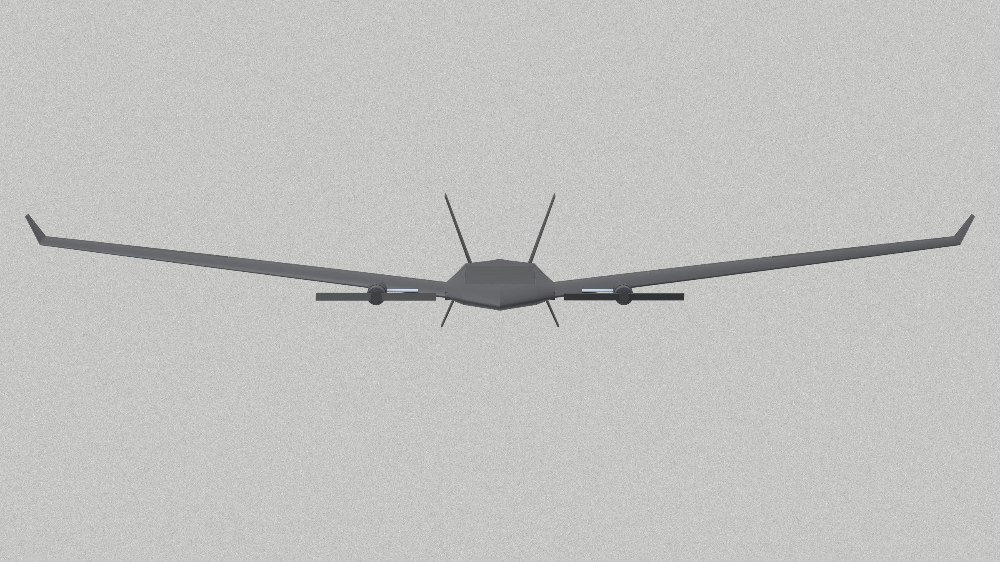
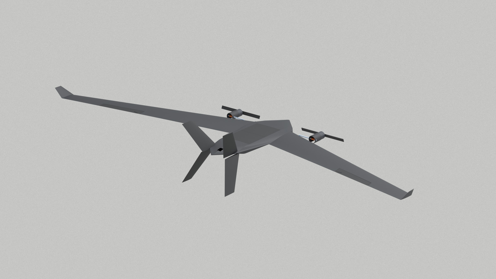

# Kestrel

**The open-source UAV development platform.**





## Kestrel-X

The reference aircraft. A 1.9 m flying wing that takes off and lands on its
tail, prints on a 220 mm bed, and runs ArduPilot.



| | |
|---|---|
| Span | 1,880 mm |
| Mass | 1,507 g |
| Endurance | 118 min |
| Range | 92 km |
| Top speed | 194 km/h |
| Stall | 37 km/h |
| Battery | 6S1P Li-ion, 86 Wh |
| Camera | Walksnail HD |
| Parts | $297.71 ([full list](PARTS_LIST.md)) |

<p>
  
  
</p>

## Start

```powershell
python -m venv .venv
```

```powershell
.venv/Scripts/python -m pip install -r requirements.txt
```

```powershell
.venv/Scripts/python sim/aircraft.py
```

## Build your own

| To | Edit | Then run |
|---|---|---|
| Swap a part | `sim/catalog.json`, `sim/aircraft.py` | `.venv/Scripts/python sim/regenerate.py --tests` |
| Change the shape | `src/printable.py` | `cad run src/check_print.py` |
| Find the best parts at a price | | `.venv/Scripts/python sim/hillclimb_v9.py` |

## Inside

| | |
|---|---|
| `src/` | Parametric CAD |
| `sim/` | Parts catalogue, simulations, tests |
| `print/` | STL files, ready to print |
| `STEP/` | Full-aircraft STEP |
| `firmware/` | ArduPilot settings |
| `cfd/` `airflow/` | CFD results |
| `readiness/` | Latest model output |

## Licence

Hardware CERN-OHL-P-2.0 · Software MIT · Documents CC BY 4.0. See [LICENSE](LICENSE).

Experimental aircraft. No weapons. Fly within the law where you live.
